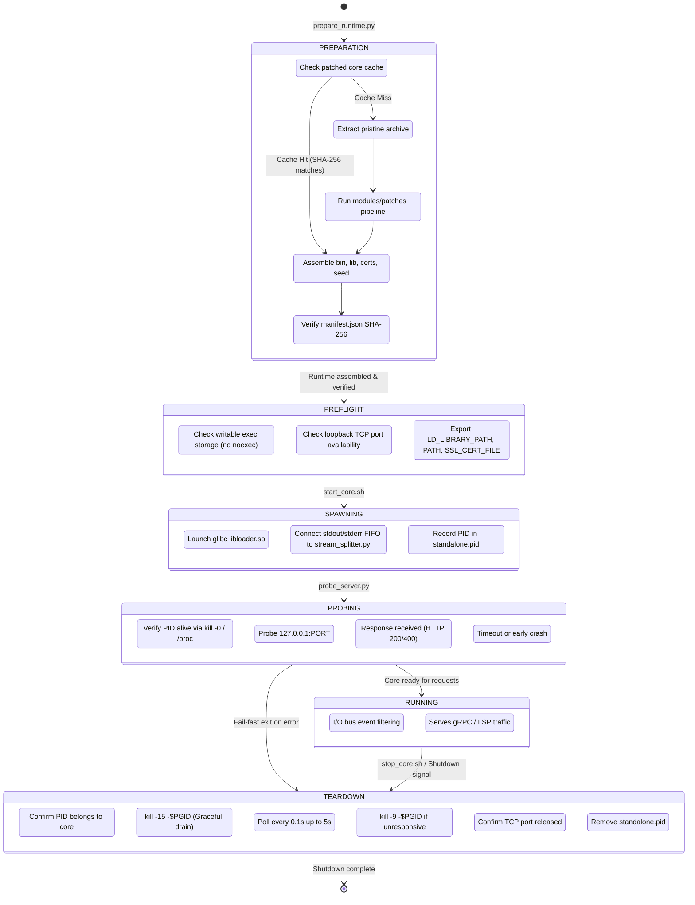

# Runtime Launcher & Supervisor Module (`modules/runner`)

> **Architecture specification and lifecycle guide for the Antigravity Standalone Core runtime on Android**

---

## 1. Architecture & File Layout

`modules/runner` orchestrates preparing, launching, probing, and gracefully stopping the standalone Antigravity v2 core runtime (`language_server`) on Android (`ARM64 / aarch64`).

```text
modules/runner/
├── auto_update.py       # Upstream release checker, extractor, patch verifier & metadata updater
├── test_auto_update.py  # Offline unit tests for auto_update.py
├── prepare_runtime.py   # Extracts/patches core and verifies runtime integrity
├── start_core.sh        # Configures glibc/Bionic env and launches core + I/O bus
├── probe_server.py      # Fail-fast readiness & liveness probe
├── stop_core.sh         # Graceful SIGTERM -> SIGKILL shutdown & cleanup
├── test_e2e.sh          # Full end-to-end integration test
└── README.md            # Runtime lifecycle specification and audit summary
```

| File | Language | Purpose | Key Dependencies |
| :--- | :--- | :--- | :--- |
| `auto_update.py` | Python 3 | Polls `antigravity.google/download`, extracts core/web, verifies patches, updates specs | `modules/patches`, `web/build.sh` |
| `test_auto_update.py` | Python 3 | Offline unit tests for upstream URL parsing, version bumps, and web ZIP sync | `unittest`, `zipfile` |
| `prepare_runtime.py` | Python 3 | Extracts pristine core, applies binary patches, builds `standalone_runtime/`, verifies `manifest.json` | `modules/core`, `modules/patches` |
| `start_core.sh` | Bash | Configures `libloader.so`, `liblse_compat.so`, FIFO log stream, and `stream_splitter.py` | `modules/io`, `libloader.so`, `liblse_compat.so` |
| `probe_server.py` | Python 3 | Polls `127.0.0.1:PORT` while watching `/proc`/PID liveness | `urllib.request`, `socket` |
| `stop_core.sh` | Bash | Verifies core PID ownership, sends `SIGTERM` with polling, escalates to `SIGKILL` if hung | Linux `/proc`, `kill` |
| `test_e2e.sh` | Bash | Automated E2E verification (assemble -> start -> probe -> inspect logs -> stop) | All runner helpers |

---

## 2. Runtime Lifecycle



### Phase Details
1. **Preparation (`prepare_runtime.py`):** Verifies cached patched core SHA-256; on miss extracts `modules/core/pristine/language_server.tar.gz`, patches via `modules/patches/pipeline.py`, assembles `bin/`, `lib/`, `certs/`, `seed/`, `etc/`, and verifies `manifest.json`.
2. **Pre-flight (`start_core.sh`):** Verifies non-`noexec` internal storage, blocks reserved ports `45157`/`45158`, and clears stale zombie core processes holding test port `45159`.
3. **Spawning (`start_core.sh`):** Invokes glibc `$LOADER --library-path "$RT/lib" [--preload "$LSE_COMPAT"] "$CORE"` inside its own process group (`set -m`) writing stdout/stderr into a named FIFO read asynchronously by `stream_splitter.py`, saving `standalone.pid`, `standalone.splitter_pid`, `standalone.pgid`, and `standalone.json`.
4. **Probing (`probe_server.py`):** Polls `127.0.0.1:45159` while calling `os.kill(target_pid, 0)` each iteration to fail immediately if `language_server` exits early.
5. **Running:** Serves Language Server / ConnectRPC requests over HTTPS while I/O filters stream events.
6. **Teardown (`stop_core.sh`):** Verifies `/proc/$PID/cmdline` contains `language_server` to guard against PID recycling, sends `SIGTERM` to `-$PGID`, polls every 0.1 s up to 5 s, escalates to `SIGKILL` only on timeout, and removes PID files.

---

## 3. Android Constraints & Guarantees

- **No `exec` on Shared Storage (`/storage/emulated/0`):** Runtime binaries must live under app-private storage (`/data/user/0/$APP_ID/files/...`).
- **Glibc vs. Bionic Isolation:** Host `python3`/`bash` link against Bionic (`$PREFIX/lib`), while `language_server` uses glibc passed strictly via `--library-path` to `libloader.so`.
- **ARMv8.0-A LSE Emulation:** Uses `liblse_compat.so` (`SIGILL` handler) on older ARM64 cores without hardware LSE atomics.

---

## 4. Audit Fixes Resolved

1. **Subshell PID mismatch (`start_core.sh`):** Switched from `( cmd | splitter ) &` to FIFO + `set -m` so the recorded PID/PGID belong directly to `language_server`.
2. **Fixed `sleep 1` before `kill -9` (`stop_core.sh`):** Replaced with 0.1 s exit polling up to 5.0 s before escalating.
3. **PID recycling hazard (`stop_core.sh`):** Validates `/proc/$PID/cmdline` matches `language_server` before signaling.
4. **Port preflight conflicts (`start_core.sh`):** Protects `45157`/`45158` and cleans stale standalone processes on `45159`.
5. **Cached binary integrity (`prepare_runtime.py`):** Verifies cached core SHA-256 before reuse.
6. **Early-crash detection (`probe_server.py`):** Checks process liveness each probe tick.
7. **Cleanup trap (`test_e2e.sh`):** Registers `trap 'bash "$SCRIPT_DIR/stop_core.sh" "$RT"' EXIT INT TERM`.
8. **Dynamic `APP_ID` resolution:** Resolves `com.agy` vs `com.agy.dev` dynamically from `AGY_APPLICATION_ID` or `$HOME`.

---

## 5. Verification Commands

```bash
# Run full E2E runtime test:
bash modules/runner/test_e2e.sh

# Run full modular test suite:
bash test_all_modules.sh

# Manual lifecycle test:
python3 modules/runner/prepare_runtime.py /data/user/0/com.agy.dev/files/standalone_runtime
bash modules/runner/start_core.sh /data/user/0/com.agy.dev/files/standalone_runtime 45159
python3 modules/runner/probe_server.py 45159 10
bash modules/runner/stop_core.sh /data/user/0/com.agy.dev/files/standalone_runtime
```
