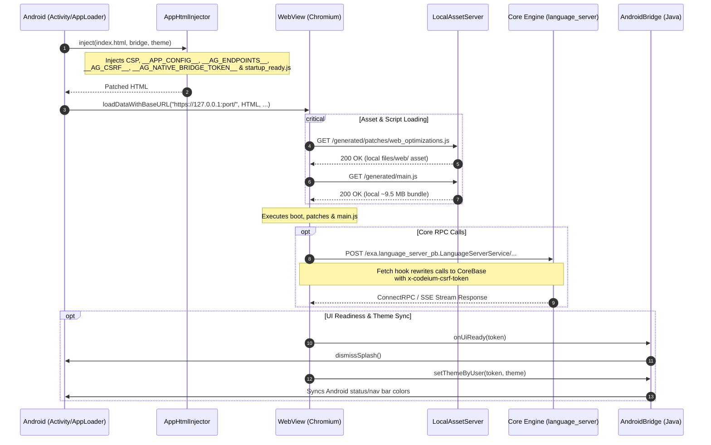

# Antigravity Web Frontend (`web/`)

> React single-page application running inside Android WebView, talking to the local Go `language_server` over loopback HTTPS and native Android via `AndroidBridge`.

---

## 1. Architecture Overview

Rather than loading from `file:///android_asset/` (which breaks modern browser APIs and ConnectRPC streaming), the frontend loads via `loadDataWithBaseURL` against the trusted loopback origin `https://127.0.0.1:<port>/`.



---

## 2. File & Directory Structure

```text
web/
├── build.sh                      # Fragment bundler + main.js patch orchestrator
├── src.manifest                  # Declarative build manifest for web/generated/**
├── patch_main.py                 # Upstream main.js patcher (Desktop Mode + Eza logo + bridge token)
├── index.html                    # Root HTML shell
├── main.js                       # Pristine upstream React UI bundle (~9.9 MB)
├── jetbox.css                    # Custom controls & terminal styles
├── compiled_tailwind.css         # Pre-compiled Tailwind CSS bundle
├── prism_bundle.js               # PrismJS syntax highlighter (deferred)
├── diff_worker.js                # Web Worker for diff calculation
├── audio_processor.js            # 16 kHz PCM AudioWorkletProcessor for voice streaming
├── antigravity-icon.png          # App icon asset
├── google_signin.svg             # Google sign-in button vector
├── symbols-icons/                # Local Material Symbols icon cache
├── workers/                      # PDF.js worker integration
│   ├── pdf.min.mjs               # PDF.js core library
│   ├── pdf.worker.mjs            # PDF parsing worker
│   └── pdfjs_loader.mjs          # Closure compiler -> ESM PDF.js bridge
├── generated/                    # Generated output bundles (built by build.sh)
│   ├── main.js                   # Patched production React bundle
│   ├── bridge.core.js            # Bridge core, polyfills, CSRF, and fetch hook
│   ├── boot/                     # Early head init scripts
│   │   ├── custom-elements-guard.js
│   │   └── theme-bootstrap.js
│   └── patches/                  # Mobile patches & bridges
│       ├── web_optimizations.js
│       ├── touch_model_menu.js
│       ├── theme_sync.js
│       ├── agent_notify.js
│       ├── clipboard_image_paste.js
│       └── startup_ready.js
├── src/                          # Modular source fragments
│   ├── boot/                     # Early boot fragments
│   ├── core/                     # Bridge core fragments (namespace, csrf, fetch, ...)
│   └── patches/                  # Patch feature fragments
└── tests/
    └── selftest.sh               # Build verification & integrity selftest
```

---

## 3. Bundling Pipeline

[`build.sh`](build.sh) reads [`src.manifest`](src.manifest) while keeping upstream `main.js` pristine — all patches apply strictly to `web/generated/main.js`.

### `src.manifest` Syntax
- `bundle iife <path>` — wraps fragments in `(function(){ ... })();` (automatically skipped if fragments already self-wrap via `is_already_iife`).
- `bundle <path>` — concatenates fragments directly.
- `src/<path>` — appends source fragment to the active bundle.

### Generated Bundles

| Bundle (`web/generated/...`) | Mode | Size | Purpose |
| :--- | :--- | :--- | :--- |
| **`boot/custom-elements-guard.js`** | IIFE | ~514 B | Guards against duplicate CustomElement registration crashes. |
| **`boot/theme-bootstrap.js`** | IIFE | ~1.3 KB | Applies `light`/`dark` class and `colorScheme` synchronously before first paint. |
| **`bridge.core.js`** | IIFE | ~16 KB | Polyfills `window.process`, config, CSRF, endpoint discovery, and `fetch` retry/stream recovery. |
| **`patches/web_optimizations.js`** | IIFE | ~5.4 KB | Disables 300 ms tap delay, tracks `visualViewport` (`--agy-vvh`), limits GPU layer hints. |
| **`patches/touch_model_menu.js`** | IIFE | ~6.7 KB | Adapts hover-only Base UI model reasoning dropdowns to touch tap sequences. |
| **`patches/theme_sync.js`** | IIFE | ~4.8 KB | Observes `<html>`/`<body>` theme classes and forwards token-gated changes to `AndroidBridge`. |
| **`patches/agent_notify.js`** | IIFE | ~3.2 KB | Bridges agent audio cues and Notification API events to native clickable Android alerts. |
| **`patches/clipboard_image_paste.js`** | IIFE | ~5.8 KB | Handles clipboard and IME (`commitContent`) image paste into the chat composer. |
| **`patches/startup_ready.js`** | IIFE | ~4.7 KB | Signals first meaningful DOM render (`onUiReady`) and captures fatal JS errors. |
| **`main.js`** | Raw + Patch | ~9.5 MB | Production React bundle patched by `patch_main.py`. |

`build.sh` verifies every generated script with `node --check` when Node.js is available.

---

## 4. Upstream Bundle Patching (`patch_main.py`)

[`patch_main.py`](patch_main.py) idempotently updates `web/generated/main.js`:
1. **Desktop Mode Toggle:** Injects `useState`/`useCallback` hooks in Appearance settings bound to `window.Android.isDesktopMode()` and token-gated `window.Android.setDesktopMode(token, v)`, inserting a Desktop Mode `Switch` under `{label:"Theme"}`. Also upgrades legacy unauthenticated `setDesktopMode(v)` calls in patched bundles to include `window.__AG_NATIVE_BRIDGE_TOKEN__`.
2. **Monochrome `Eza` Logo:** Replaces hardcoded multicolor SVG fills with theme-aware `text-[#9AA0A6]` / `text-[#5F6368]` strokes.

---

## 5. Native Android Bridge (`AndroidBridge`)

`AppHtmlInjector` injects strict CSP headers, `window.__APP_CONFIG__`, `window.__AG_ENDPOINTS__`, `window.__AG_CSRF__`, `window.__AG_HOST_THEME__`, `window.__AG_NATIVE_BRIDGE_TOKEN__`, and `./generated/patches/startup_ready.js`.

| Method | Signature | Purpose |
| :--- | :--- | :--- |
| `onUiReady` | `(token: string) => void` | Dismisses the native splash overlay on first meaningful DOM paint. |
| `onUiError` | `(token: string, message: string) => void` | Reports fatal startup JS errors to native logs and error UI. |
| `setTheme` | `(token: string, mode: string) => boolean` | Applies theme programmatically with token verification. |
| `setThemeByUser` | `(token: string, theme: string) => boolean` | Sends user-selected `light`/`dark` theme to update Android system bars. |
| `onVisualThemeChanged` | `(token: string, theme: string) => void` | Notifies Android of active CSS theme updates. |
| `getTheme` | `() => string` | Returns current host theme. |
| `isDesktopMode` | `() => boolean` | Returns current Desktop Mode state. |
| `setDesktopMode` | `(token: string, enabled: boolean) => void` | Switches WebView User-Agent and viewport layout (token-gated). |
| `openDirectoryPicker` | `(token: string) => void` | Opens Android SAF folder picker for project selection (token-gated). |
| `saveBlob` | `(token, base64, filename, mime) => void` | Saves generated Base64 blobs safely via `FileDownloader` into Downloads. |
| `notifyAgentEvent` | `(token, type, title, body) => void` | Fires clickable background agent notifications when backgrounded. |
| `hasClipboardImage` | `(token) => boolean` | Checks clipboard `ClipDescription` MIME types without triggering Android 12+ paste toast. |
| `requestClipboardImagePaste` | `(token) => void` | Asynchronously decodes/downscales clipboard images into `window.__agPasteImage`. |
| `readClipboardImage` | `(token) => string` | Synchronous clipboard image JSON fallback. |

---

## 6. Subsystems & Workers

- **Theme Engine:** `theme-bootstrap.js` sets initial colors synchronously before paint; `theme_sync.js` syncs dynamic theme changes via `MutationObserver`, `storage`, and `matchMedia`.
- **Mobile & Touch (`web_optimizations.js`, `touch_model_menu.js`):** Eliminates 300 ms tap delay, keeps `--agy-vvh` synced with `visualViewport` during IME opening, and synthesizes pointer/keyboard events for hover-based model submenus.
- **Core Transport (`bridge.core.js`):** Stubs `window.process`, rewrites ConnectRPC `/exa.*` fetches to `https://127.0.0.1:<enginePort>` with `x-codeium-csrf-token`, retries startup bursts (`fetchWithStartupRetry`), tracks long-lived server-streaming RPCs (e.g., `StreamAgentStateUpdates`) with an internal `AbortController` + pass-through `ReadableStream` handle, and actively force-resets stalled streams on `agy:host-resume` / `agy:network-online` / `visibilitychange` (deferred if hidden) without aborting the caller's signal so `main.js` reconnects and hydrates completed state.
- **Workers & Audio:** Offloads PDF rendering (`pdf.worker.mjs`), Myers diff calculations (`diff_worker.js`), and 16 kHz microphone downsampling (`AudioWorkletProcessor`).

---

## 7. Audit Status & Remaining Hardening Targets

| Issue | Location | Status / Recommendation |
| :--- | :--- | :--- |
| Auto-build `web/` during APK packaging | `modules/builder/05_stage_assets.py` | **[Fixed]** Automatically runs `bash web/build.sh` before staging. |
| `src.manifest` leaked into APK assets | `modules/builder/05_stage_assets.py` | **[Fixed]** Excluded `"src.manifest"` in `web_ignore`. |
| Double IIFE wrapping | `web/build.sh`, `theme-bootstrap.js` | **[Fixed]** Added `is_already_iife` check in `build.sh`. |
| Android `/tmp` dependency | `web/build.sh` | **[Fixed]** Uses portable `${TMPDIR:-${HOME:-.}/.tmp}`. |
| Fragile regex patching on minified `main.js` | `web/patch_main.py` | Consider AST/structured checks on future upstream UI updates. |
| Static `'agy-standalone-token'` fallback | `web/src/core/csrf.js` | Generate random hex fallback when DOM/injected token is absent. |
| HTTP scheme in `?port=` discovery | `web/src/core/endpoints.js` | Normalize `ENDPOINTS.core_http` to `https://127.0.0.1:` to match TLS transport. |
| Fixed 70ms/260ms delays in touch submenu | `web/src/patches/touch_model_menu/` | Consider `MutationObserver` confirmation under heavy CPU load. |

---

## 8. Verification

```bash
bash web/tests/selftest.sh
```

Verifies isolated copy integrity, confirms upstream `web/main.js` SHA-256 stays unmodified, validates all generated bundles (`node --check`), checks there are no double-wrapped IIFEs, and runs a Node.js behavioral check confirming `agy:host-resume` resets stalled `StreamAgentStateUpdates` streams (deferring while hidden) without aborting caller signals or unary/audio RPCs.
